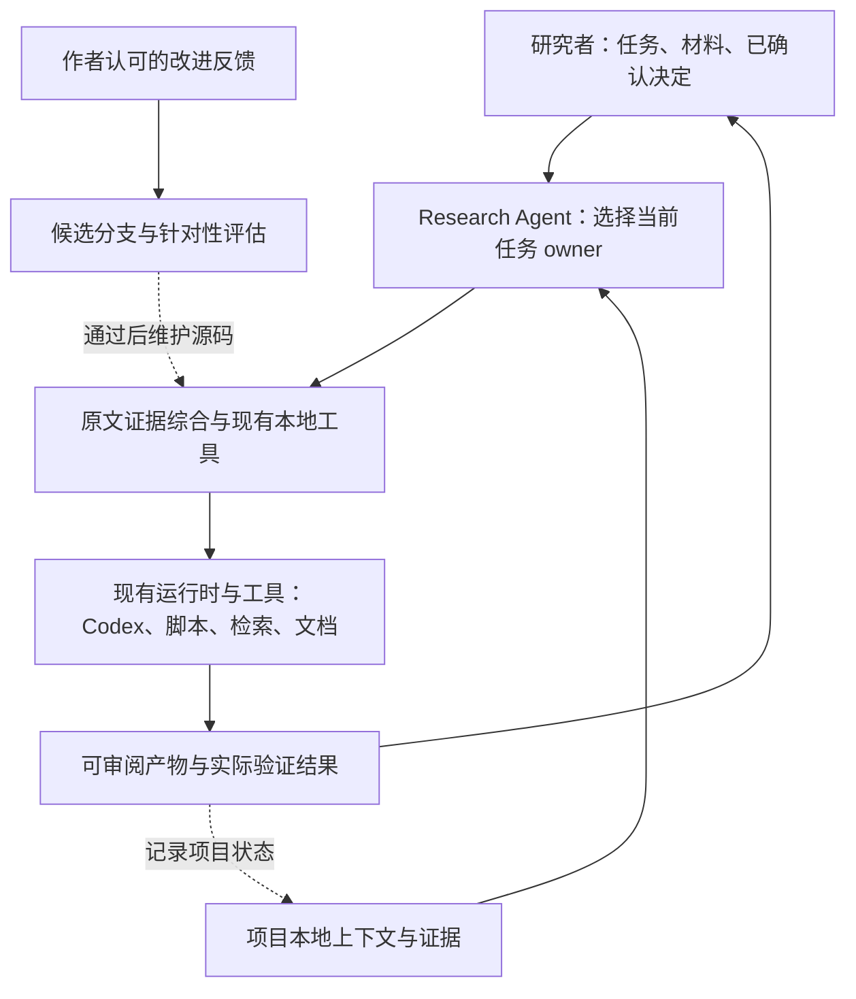

# 系统边界

## 研究者主导的协作

你提出当前任务、指定材料和约束。Research Agent 选择一个主要 owner，按需使用
检索、下载、证据审计、格式化等支持能力，在已授权范围内完成工作。
必要的工具调用无需逐步询问；研究问题、实质方法取舍、主张或受保护产物发生
变化时，才把有证据支撑的选项交给作者。

`nature-scientific-insight`（科研洞察与判断）是作者于 2026-10-13 指定的核心技能：独立判断任务由它
负责；发现、设计、结果解释与写作按需复用其标准及已成立的判断。Research Agent
负责当前任务协调，作者保留科学取舍。纯语言编辑和已确认方案的普通执行直接
使用对应技能，核心判断不形成自动阶段链。

它交付研究价值、贡献、解释可信度与下一步科学取舍建议；领域图谱及新候选仍由
`nature-research-discovery` 负责，可实施方法及完整实验计划仍由 `nature-method-design`、`nature-experiment-plan` 负责。
可以在选题、设计或结果阶段调用，不固定在“读完文献”之后，也不新增平行入口。

## 四类信息分别维护

| 信息 | 存放位置 | 用途 |
|---|---|---|
| 可复用技能与工具 | 本仓库 `skills/`、`scripts/` | Git 版本管理与改进 |
| 科研协作偏好 | 本文及相关 owner | 中文优先、证据边界、修订粒度 |
| 项目事实与已确认决定 | 研究项目已有 `.agent/` 或等效文件 | 跨会话恢复与当前证据定位 |
| 凭据、API 配置、论文库、未公开案例 | 运行环境与研究项目；本仓库外 | 按任务授权使用 |

现有 `.agent/NEXT.md`、`STATE.md` 足以承担恢复入口，不建立第二套项目记忆库。
长期稳定背景、已确认决策与短期工作状态分开；任何记忆都不能替代原文件证据。

## 当前明确保留的科研习惯

- 中文沟通优先，中文与英文论文均可处理；语言润色保持事实和主张强度。
- 从作者指定阶段开始；采用已认可的摘要、大纲和当前正式稿作为相应权威。
- 引用核对回到原文；检索命中和知识库片段只提供候选证据。
- 对科学对象、分析尺度、对照、指标和因果强度保持精确。
- 先完成可复核的具体工作；正式稿与修改说明分开交付。
- 真实失败驱动技能改进，既有规则执行失误不直接导致更多规则。
- 图形沿用现有 figure owner；数据正确性、可编辑性和渲染可读性分别验证。
- 作者保留科研判断。默认不启动多代理、阶段流水线、日程或自我修改。

## 能力边界与复用

按交付物选择一个主要 owner，已有充分输入时直接进入该任务：

| 交付物 | 主要 owner | 支持边界 |
|---|---|---|
| 研究价值、创新性、方法价值、证据强度、主张选择与研究去留判断 | `nature-scientific-insight` | 复用已有原文与分析；建议改变问题或核心主张交给作者决定 |
| 论文、学位论文章节与论证重构 | `nature-writing` | `nature-proposal-writer` 只负责 proposal、开题与研究计划 |
| 已有文本的润色、翻译与同论证压缩 | `nature-polishing` | 不另选科学主线或改变证据使用；纯排版由 `nature-paper-format` 负责 |
| 投稿图件设计、渲染与审查 | `nature-figure` | 核验数据直接绘制；新计算由 `nature-data-analysis` 完成，同一图只使用一个渲染流程 |
| 系统综述方法与跨论文综合资产 | `nature-literature-synthesis` | 数值执行交给 `nature-data-analysis`，论文正文交给 `nature-writing` |
| 数据执行与已完成结果解释 | `nature-data-analysis` 的计算或结果解释模式 | 只需解释时复用已完成计算 |
| 溯源审计与模拟审稿 | `nature-evidence-audit` 或 `nature-reviewer` | 按所需审查产物选择，不自动串联 |

OpenSpec 是已有工作包的记录工具，不是所有任务的入口。科学定义保留在其权威文档，
工作包链接要求与验收，`.agent/` 保存恢复指针。owner 模板只补缺失字段，
不生成第二份任务状态。ARS 保留为停用参考；项目内 vNext 只供明确选择的候选任务。
默认入口不混用这些写作方法，也不新增统一验证 Agent。

2026-10-12 的逐项诊断、完整技能处置清单和修改边界见
[架构重叠审查](architecture_review.md)。

科学发现与外部 AI for Science 建议的核验和选择性优化见
[科学发现审查](scientific_discovery_review.md)；发现、方法与实验设计复用
`nature-research-discovery`、`nature-method-design`、`nature-experiment-plan`，不新增自动运行的五层 Agent 链。

## 首版能力边界

当前仓库已经覆盖技能源码版本管理、维护检查、参考设计分析和评估流程。
以下仍由原安装或项目提供：技能发现、模型/tool loop、权限、Word/PPT/Origin、
私有知识库及全文获取账户。`stage` 只复制到新目录供审阅，不安装、不激活。

这种分层允许今后更换运行时，但尚未实现跨运行时适配。只有现有运行时在真实
科研任务中出现可复现的缺口时，才考虑抽取新的执行组件。
