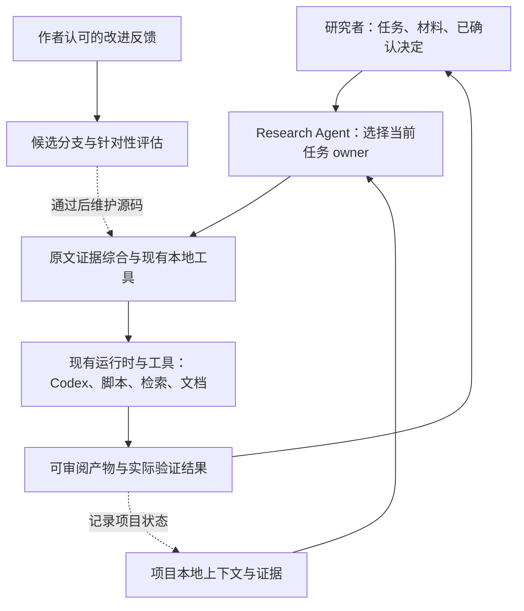

# 系统边界

## 研究者主导的协作

你提出当前任务、指定材料和约束。Research Agent 选择一个主要 owner，按需使用
检索、下载、证据审计、格式化等支持能力，在已授权范围内完成工作。
必要的工具调用无需逐步询问；研究问题、实质方法取舍、主张或受保护产物发生
变化时，才把有证据支撑的选项交给作者。

`nature-scientific-insight`（科研洞察与判断）是作者于 2026-10-13 指定的核心技能：独立判断任务由它
负责；发现、设计、结果解释与写作按需复用其标准及已成立的判断。Research Agent
负责当前任务协调，作者保留科学取舍。纯语言编辑和已确认方案的普通执行直接
使用对应技能，核心判断不形成自动阶段链。

它交付研究价值、贡献、解释可信度与下一步科学取舍建议。2026-10-25 按作者要求，
领域图谱、候选选题、文献调研与初始框架默认由 ARS 精选入口
`academic-research-suite` 负责；从已有环境观测、数据条件或先行研究发展过程
假设及区分性验证时，自动使用 `nature-research-discovery`。路由从任务和材料
推断，无需作者确认学科或技能，同一任务不重复发现。可实施方法及完整实验计划由 `nature-method-design`
的相应模式负责，论文生产继续使用 Nature。完整边界见
[ARS 与 Nature 协作](ars_nature_workflow.md)。
可以在选题、设计或结果阶段调用，不固定在“读完文献”之后，也不新增平行入口。

## 四类信息分别维护

| 信息 | 存放位置 | 用途 |
|---|---|---|
| 可复用技能与工具 | 本仓库 `skills/`、`scripts/` | Git 版本管理与改进 |
| 科研协作偏好 | 本文及相关 owner | 中文优先、证据边界、修订粒度 |
| 项目事实与已确认决定 | 研究项目已有 `.agent/` 或等效文件 | 跨会话恢复与当前证据定位 |
| 凭据、API 配置、论文库、未公开案例 | 运行环境与研究项目；本仓库外 | 按任务授权使用 |

现有 `.agent/NEXT.md`、`STATE.md` 足以承担恢复入口，不建立第二套项目记忆库。
长期稳定背景、已确认决策与短期工作状态分开；任何记忆都不能替代原文件证据。

## 当前明确保留的科研习惯

- 中文沟通优先，中文与英文论文均可处理；语言润色保持事实和主张强度。
- 从作者指定阶段开始；采用已认可的摘要、大纲和当前正式稿作为相应权威。
- 引用核对回到原文；检索命中和知识库片段只提供候选证据。
- 相关研究、补引用与实质写作默认先使用本地精选论文，已有充分证据直接复用；
  缺少最新、近邻、反证或覆盖时补外部检索。写作范例优先选择问题、文类和证据
  适配的 NCS 与领域 Top 期刊。整篇研究中的构思、设计、方法、分析、图件及
  写作均可按任务学习；重点学习摘要、引言和讨论共同形成的科学叙事，并对照
  结果与图件，把主线、信息顺序和意义展开用于实际稿件。
- 手稿写作需要本地文献时，由 Research Agent 自动执行上下文回读并补读必要范围，
  不要求作者运行检索命令。统一“科研文献库”入口覆盖修复主库、补充、Zotero、专题和有效增量；
  “研究笔记库”和“图件参考库”保留各自证据用途，历史目录名继续作为内部来源标识。具体调用与
  分页约定位于 `nature-literature-kb`；写作 owner 负责读原文、核对证据并继续成稿。
- 对科学对象、分析尺度、对照、指标和因果强度保持精确。
- 先完成可复核的具体工作；正式稿与修改说明分开交付。
- 真实失败驱动技能改进，既有规则执行失误不直接导致更多规则。
- 图形沿用现有 figure owner；数据正确性、可编辑性和渲染可读性分别验证。
- 作者保留科研判断。默认不启动多代理、阶段流水线、日程或自我修改。

## 能力边界与复用

按交付物选择一个主要 owner，已有充分输入时直接进入该任务：

| 交付物 | 主要 owner | 支持边界 |
|---|---|---|
| 研究价值、创新性、方法价值、证据强度、主张选择与研究去留判断 | `nature-scientific-insight` | 复用已有原文与分析；建议改变问题或核心主张交给作者决定 |
| 对 idea、手稿或交付作品提出最强有据反对意见 | `ai-skeptic`（AI怀疑者） | 按需提供质疑、影响和解除条件；不自动增加评审轮次，科学取舍与正式审稿保留原分工 |
| 对生活、学习、投资、职业和跨领域资源选择提供决策建议 | `nature-decision` | 直接应用内置的公开资料蒸馏卡，比较选项、风险与反转条件；保留个人隐私和用户决定权，纯科研判断默认仍由 `nature-scientific-insight` 负责，明确要求名家视角时使用本技能 |
| 从公开材料提炼新的学者或公众人物判断框架 | `nature-scholar-distiller` | 提供可核查的来源、事实与有限推断；具体决策按需交给 `nature-decision`，不模拟名人或声称已实现自动个人记忆 |
| 论文、学位论文章节与论证重构 | `nature-writing` | `nature-proposal-writer` 只负责 proposal、开题与研究计划 |
| 已有文本的润色、翻译与同论证压缩 | `nature-polishing` | 不另选科学主线或改变证据使用；纯排版由 `nature-paper-format` 负责 |
| 投稿图件设计、渲染与审查 | `nature-figure` | 核验数据直接绘制；新计算由 `nature-data-analysis` 完成，同一图只使用一个渲染流程 |
| 系统综述方法与跨论文综合资产 | `nature-literature-synthesis` | 数值执行交给 `nature-data-analysis`，论文正文交给 `nature-writing` |
| 数据执行与已完成结果解释 | `nature-data-analysis` 的计算或结果解释模式 | 只需解释时复用已完成计算 |
| 溯源审计与模拟审稿 | `nature-evidence-audit` 或 `nature-reviewer` | 按所需审查产物选择，不自动串联 |

OpenSpec 是已有工作包的记录工具，不是所有任务的入口。科学定义保留在其权威文档，
工作包链接要求与验收，`.agent/` 保存恢复指针。owner 模板只补缺失字段，
不生成第二份任务状态。旧 ARS 写作适配保留为停用参考，新的精选 ARS 只负责
前期规划；项目内 vNext 只供明确选择的候选任务。默认入口按交付物分工，
不启用完整 ARS 写作流水线，也不新增统一验证 Agent。

2026-10-12 的逐项诊断、完整技能处置清单和修改边界见
[架构重叠审查](architecture_review.md)。

科学发现与外部 AI for Science 建议的核验和选择性优化见
[科学发现审查](scientific_discovery_review.md)；发现、方法与实验设计复用
`nature-research-discovery`、`nature-method-design` 的方法方案与 experiment-plan 模式，不新增自动运行的五层 Agent 链。

## 首版能力边界

当前仓库已经覆盖技能源码版本管理、维护检查、参考设计分析和评估流程。
以下仍由原安装或项目提供：技能发现、模型/tool loop、权限、Word/PPT/Origin、
私有知识库及全文获取账户。`stage` 只复制到新目录供审阅，不安装、不激活。

这种分层允许今后更换运行时，但尚未实现跨运行时适配。只有现有运行时在真实
科研任务中出现可复现的缺口时，才考虑抽取新的执行组件。
